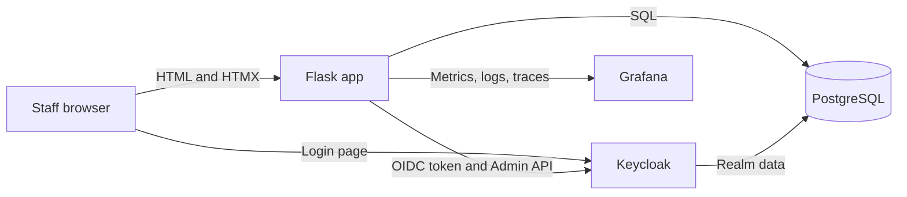
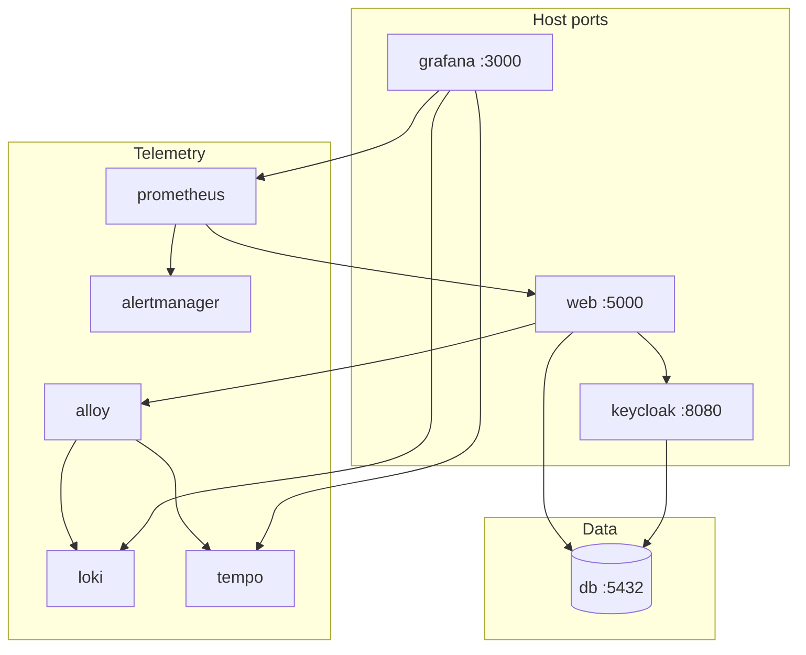
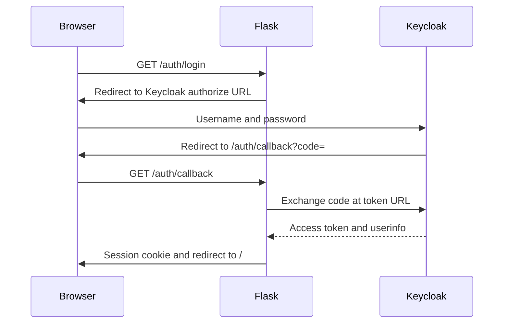
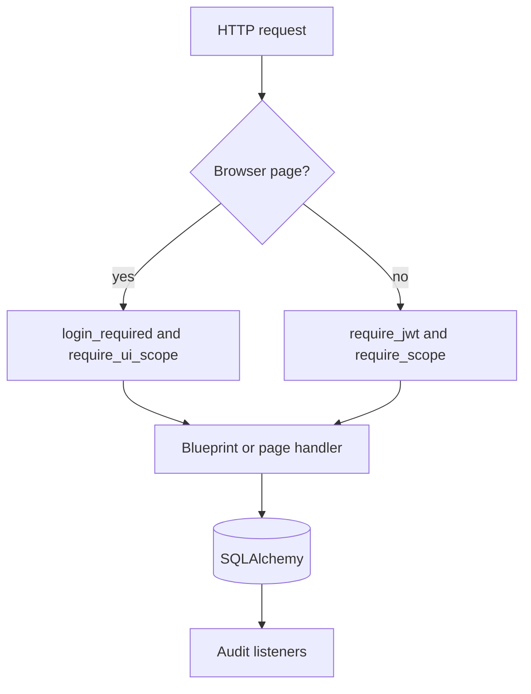
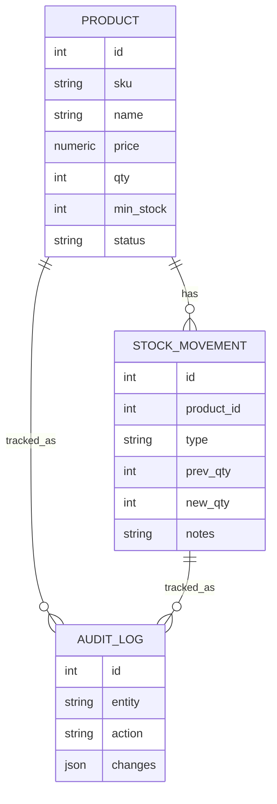
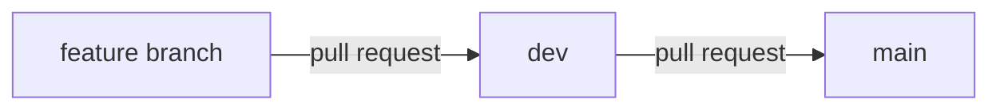

# Architecture

The system is one Flask process that renders HTML and serves a JSON API. PostgreSQL stores inventory data. Keycloak stores users and roles. Grafana reads metrics, logs, and traces produced by the application.

## System context

## Containers

`docker-compose.yml` is the local stack. `docker-compose.staging.yml` runs the same services without mounting the source tree. `docker-compose.ci.yml` is the smaller set used by automated tests: Postgres, Keycloak, and Flask.

In the local and CI stacks Keycloak may share the Postgres instance with the application. Staging creates a separate `keycloak` database on that instance so realm tables are not mixed with inventory tables.

## Sign-in sequence

The session stores the user profile and the scope list. It does not store the raw access token. API calls send `Authorization: Bearer` and are checked again on each request.

## Request path inside Flask

Page routes live in `app/main.py`. JSON routes live in the blueprints under `app/products`, `app/stock`, `app/reports`, `app/audit`, `app/users`, and `app/auth`.

## Data model

Users and role mappings are Keycloak entities, not tables in this schema.

## Branch flow

`dev` is the integration branch named `develop` in the original six-week plan. Short-lived work uses `feature/*`.
